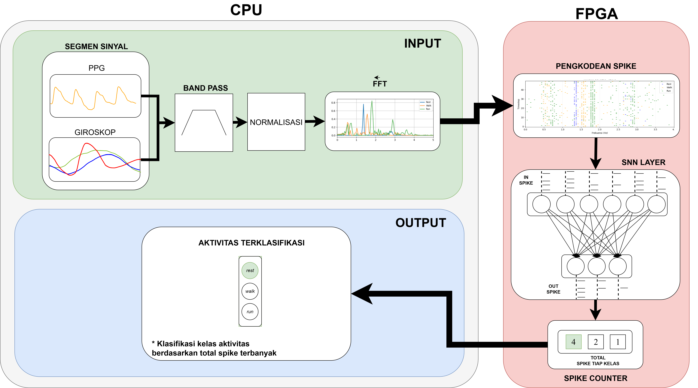

# SNN-based Human Activity Recognition from PPG on FPGA

Undergraduate final project

## Overview
Wearable HAR from PPG is limited by power and inference cost. This project implements an LIF-based SNN accelerator:

1. **Preprocessing** – PPG motion-artifact cancelation (MAC) using the gyroscope as motion reference; raises accuracy from 34.9 % to 82 % (rest / walk / run).
2. **Training** – snnTorch, rate vs. latency spike coding, offline; weights quantized to fixed-point **Q2.6**.
3. **RTL** – modular SystemVerilog (neuron / layer / network, FSM control units). A Python generator (veriloggen) emits a network for any neuron count and layer count; verified with cocotb + Verilator.
4. **FPGA** – AXI-Lite IP in a Zynq block design (Vivado 2023.2), driven from PYNQ; power measured on the FPGA core rail.

## Results (from the thesis)
| Metric | Value |
|---|---|
| Offline accuracy (rate, model 1 / model 2; latency model 1) | 82.80 % / 85.2 % / 85.3 % |
| RTL simulation accuracy (rate 1 / rate 2 / latency 1) | 81.64 % / 84.4 % / 67.0 % |
| FPGA accuracy (Q2.6, rate model 1) | **81.60 %** (1.07 % below the Q2.6 simulation, 82.67 %; 1.2 % below float offline, 82.80 %) |
| Mean inference latency | 15.608 ms (15.522 ms PS I/O + 0.086 ms SNN core on PL) |
| Mean energy per inference | **0.462 mJ** (SNN in software on the PS: 1.18 mJ) |

## Architecture
See **[docs/ARCHITECTURE.md](docs/ARCHITECTURE.md)** for the full SNN architecture (preprocessing → spike encoding → LIF neuron / layer / network RTL → Zynq AXI integration), with the thesis figures, FSMs, quantization and measurement setup.



```
PPG+gyro -> MAC preprocessing -> spike encoding (PS) -> AXI-Lite -> SNN RTL (PL) -> spike counter -> argmax (PS)
```

## Repository layout
```
training/   snnTorch notebook, trained models (.pth), quantized weights (.coe)
rtl/        SystemVerilog modules, Python network generator, cocotb tests, generated networks
fpga/       Vivado block-design/IP tcl, RTL sources, custom AXI IP wrapper, bitstream (+hwh), PYNQ test notebook
results/    Raw power measurements (CPU, CPU+FPGA) and summary workbook
docs/       Architecture write-up and thesis figures
xschem/     Earlier analog CMOS (sky130) LIF neuron / Schmitt-trigger schematics from the original proposal
```

## Reproducing
**Dataset** – see `training/data/README.md` (not redistributed).

**Train** – `pip install -r training/requirements.txt`, open `training/training_latency_vs_rate.ipynb`. Spike test sets (`*.npy`, up to ~100 MB) are regenerated by the notebook and are git-ignored.

**Generate RTL & simulate**
```bash
pip install -r rtl/requirements.txt          # plus Verilator
cd rtl
python example.py                            # see build_network/gen_network.py; point weights_file to ../training/weights/*.coe
make                                         # cocotb + Verilator (test_snn.py)
```
Pre-generated networks are in `rtl/generated/` (`build_SNN`, `build_rate_SNN_rate`, `build_lat_SNN_lat`, `build_latency_SNN_latency`, `build_new_SNN`). Their cocotb tests need the corresponding spike `.npy` files from the training notebook.

**FPGA** – Vivado 2023.2, Zynq-7000 board: create a project, add `fpga/srcs/rtl`, `fpga/axi_ip`, then `source fpga/design_2_32_64_3.tcl` to rebuild the block design. A prebuilt `fpga/design_2_32_64_3.bit/.hwh` pair can be loaded directly from PYNQ with `fpga/pynq/snn_test_FPGA.ipynb`. Spike inputs (`x_test_spikes.npy`, `y_test_spikes.npy`) come from the training notebook.

## Not included
Thesis book, proposal, posters, slides and papers (personal/signed documents), the third-party dataset, and Vivado/Verilator build output.

## Citation / credits
Dataset: H. Lee, H. Chung, J. Lee, IEEE Sensors J., doi:10.1109/JSEN.2018.2879970 (BAMI Lab, Wonkwang University).
No license has been chosen yet; all rights reserved by the author until one is added.
