# SNN Architecture

Architecture of the PPG-based Human Activity Recognition (HAR) Spiking Neural Network, as described in the thesis (Chapters 3–4) and cross-checked against the RTL in this repository. Figures are from the thesis (labels in Indonesian).

Classes: **rest / walk / run**. Dataset after preprocessing: 21,096 windows (14,767 train / 6,329 test: rest 3,430/1,466, walk 5,603/2,389, run 5,734/2,474).

## 1. System overview

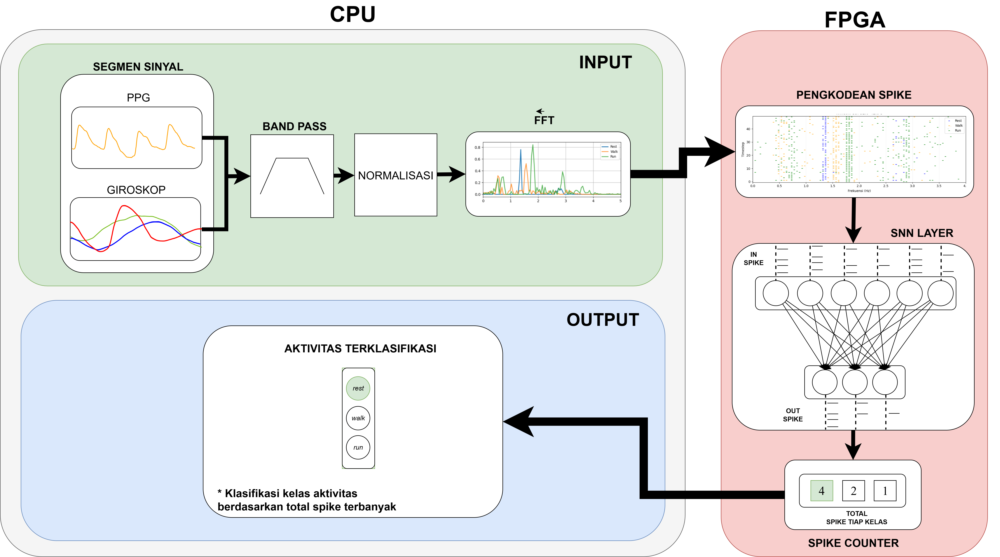

The Zynq-7000 **Processing System (PS / CPU)** does preprocessing and spike encoding and interprets the result; the **Programmable Logic (PL)** runs the SNN. The PL returns one spike count per class; the class with the most spikes wins.

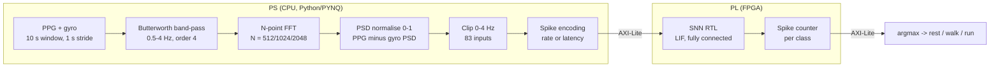

## 2. Preprocessing (motion-artifact cancelation, MAC)
1. Segment PPG and 3-axis gyroscope (sliding window 10 s, shift 1 s; 50 Hz data).
2. 4th-order Butterworth band-pass 0.5–4 Hz.
3. N-point FFT; average the three gyro PSDs → motion-artifact estimate `P_G`; PPG spectrum `P_S`; both normalised to 0–1.
4. Corrected spectrum `P_C = (1 − P_G / P_S) · P_S`, clipped to 0–4 Hz (83 bins → 83 network inputs).

Effect: accuracy 34.9 % → 82 % (rest/walk/run). Gyroscope is used as the reference because it removes motion artifact better than the accelerometer.

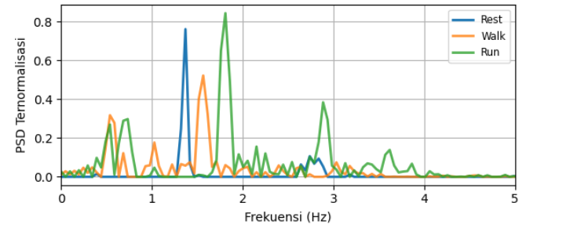

## 3. Spike encoding
| Scheme | Timesteps | Idea |
|---|---|---|
| Rate | 5 / 10 / **20** (and 50 for model1) | spike probability ∝ spectral amplitude |
| Latency | **10** | larger amplitude → earlier spike |

The RTL accepts **1-bit spikes** per input per timestep.

| Rate (20 timesteps) | Latency (10 timesteps) |
|---|---|
| 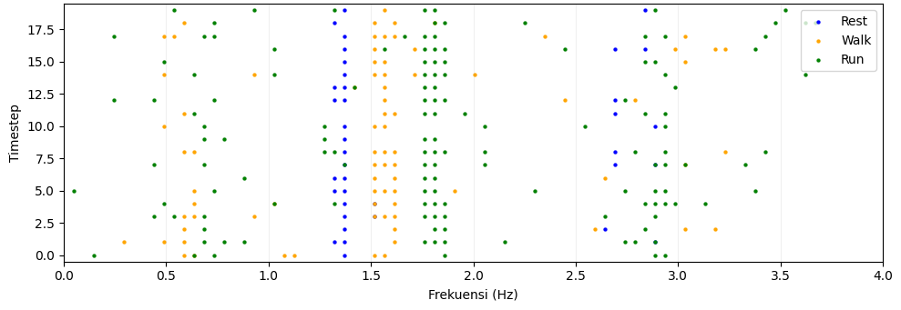 | 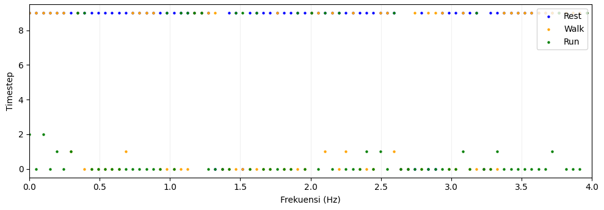 |

## 4. Network topology and neuron model
Fully connected multilayer SNN, trained offline with snnTorch (Adam, lr 0.001, surrogate-gradient, 50 epochs). Final models:

| Model | Topology | Timesteps | Offline acc. | RTL sim acc. |
|---|---|---|---|---|
| `model1_rate` | 32–64–3 | 50 | 82.80 % | 81.64 % |
| `model2_rate` | 83–64–32–3 | 20 | 85.2 % | 84.4 % |
| `model1_latency` | 83–64–32–3 | 10 | 85.3 % | 67.0 % |

Neuron: **Leaky Integrate-and-Fire**, **reset-by-subtraction**, **excitatory synapses only**, **no bias**. Parameter study (rate coding):

| Parameter | Option → accuracy |
|---|---|
| Reset | subtract **82.0 %** vs zero 79.6 % |
| Decay τ / threshold | manual (0.99 / 1) 82.0 % vs learned 81.7 % |
| Bias | on 82.0 % vs off 80.7 % → **off** (RTL resource cost) |
| Inhibitory synapses | on 68.2 % vs off 82.0 % → **off** |
| Timesteps | 5: 76.1 %, 10: 82.0 %, 20: 85.2 % (accuracy vs latency trade-off) |

| Rate coding | Latency coding |
|---|---|
| 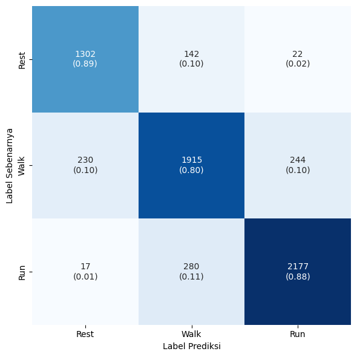 | 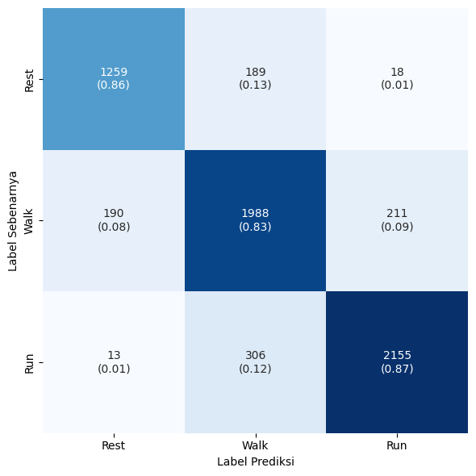 |

### Quantization
Weights are exported as 8-bit fixed point `Q(M.N)` `.coe` files (ROM init). Accuracy drops as integer bits increase; **Q2.6** was chosen because Q1.7 cannot represent thresholds > 1.0 (which blocks learned thresholds).

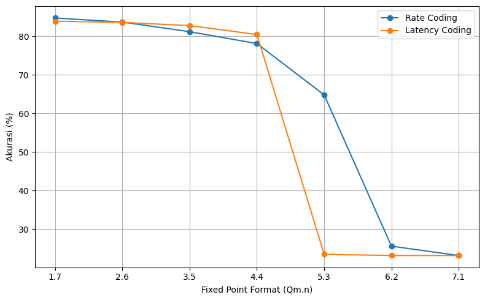

| Stage | Weights | Accuracy |
|---|---|---|
| Offline training | float32 | 82.80 % |
| Quantized simulation | Q2.6 | 82.67 % |
| FPGA | Q2.6 | **81.60 %** |

## 5. RTL architecture (SystemVerilog, `rtl/verilog/`)
Three levels — **neuron → layer → network** — each with a control unit (FSM) and data path. Parameters (neuron count, layer count, bit width `WIDTH`, leak `SHIFT`, thresholds, ROM contents) are set by the Python generator (`rtl/build_network/`, veriloggen), so any fully connected topology can be generated.

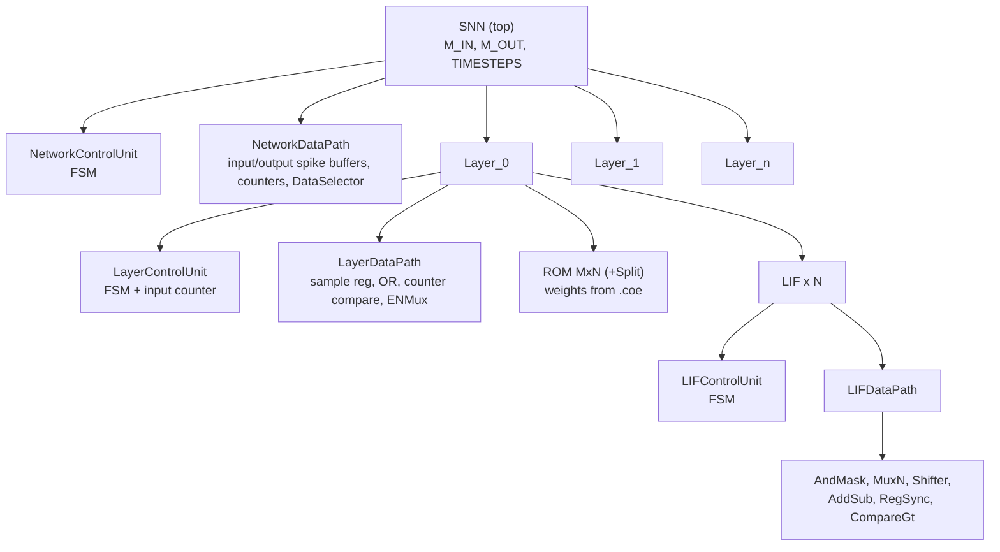

### 5.1 LIF neuron (`neuron/hdl/LIF*.sv`)
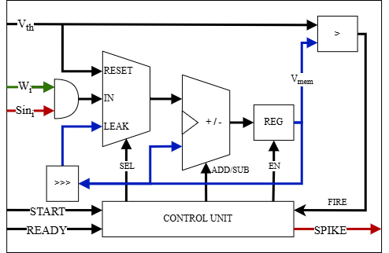

- `AndMask` gates the weight with the input spike (spike × weight without a multiplier).
- A 3-way `MuxN` selects the update term: **weight** (integrate), **`v >> SHIFT`** (leak: `v ← v − v/2^SHIFT`, β ≈ 1 − 2^−SHIFT), or **`v_th`** (reset-subtract: `v ← v − v_th`).
- `AddSub` + `RegSync` (membrane register `v`); `CompareGt` raises `exceed_v_th` → `out_spike`.
- Interface: `clk, rst, restart, exc, leak, exc_spike, v_th, exc_weight → neuron_ready, out_spike`.

FSM: `RESET → INIT → IDLE → {EXCITE (while exc) | LEAK} → FIRE → IDLE`; `restart` from IDLE returns to INIT.

| FSM | Timing |
|---|---|
| 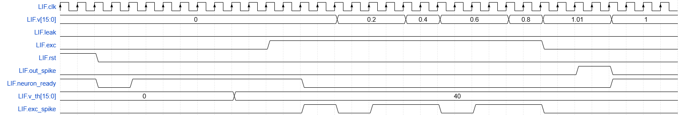 | |

### 5.2 Layer (`layer/hdl/`)
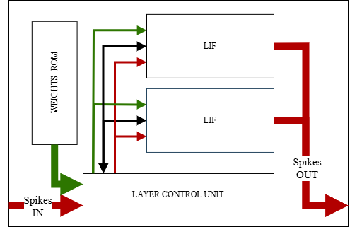

A layer = **Layer Control Unit + Weights ROM + N LIF neurons**. On `layer_start`, the input spike vector is latched into a register (`RegSync`) and a counter walks the `n_in` inputs serially: an enabled mux (`ENMuxN`) picks one input spike while the ROM supplies that input's weights, broadcast to all neurons in parallel (one weight per neuron). `CompareEq` on the counter signals the last input. An **OR gate over the input spikes** skips integration when all spikes are zero (no `exc_yes`) and jumps straight to leak, saving cycles. `layer_ready` indicates all neurons can take the next timestep.

| Control unit | FSM |
|---|---|
| 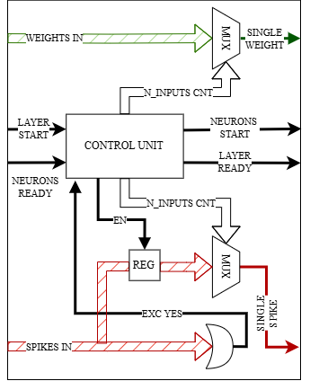 | 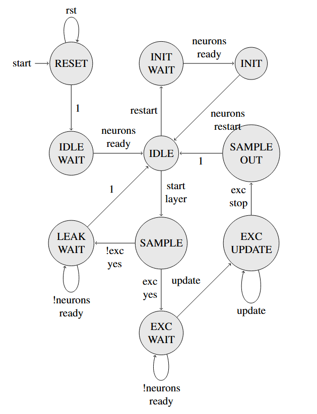 |

### 5.3 Network / top level (`network/hdl/`, `Network.sv` / `SNN.sv`)
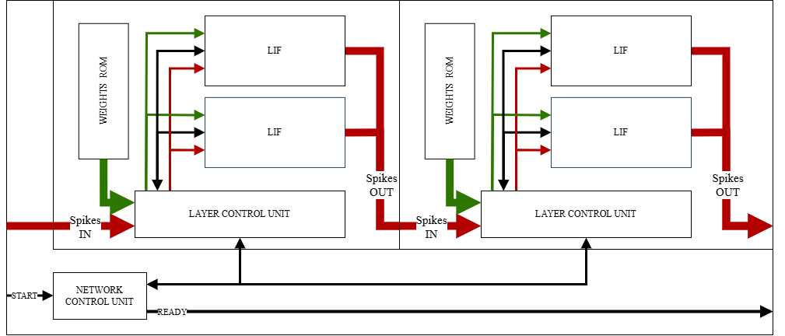

```
SNN #(M_IN, M_OUT, TIMESTEPS)
  in : clk, rst, start, sample_ready, in_spikes_buffer[0:TIMESTEPS-1][M_IN-1:0]
  out: ready, out_spikes_buffer[0:TIMESTEPS-1][M_OUT-1:0]
```
The whole spike train (all timesteps) is latched into an input buffer; the network control unit steps the layers timestep by timestep (`sample = &layer_ready & sample_ready`), collects output spikes into the output buffer, and asserts `ready`. Spike counting per class is done on the output buffer.

| Network control unit | FSM |
|---|---|
| 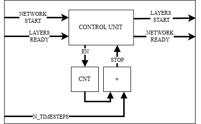 | 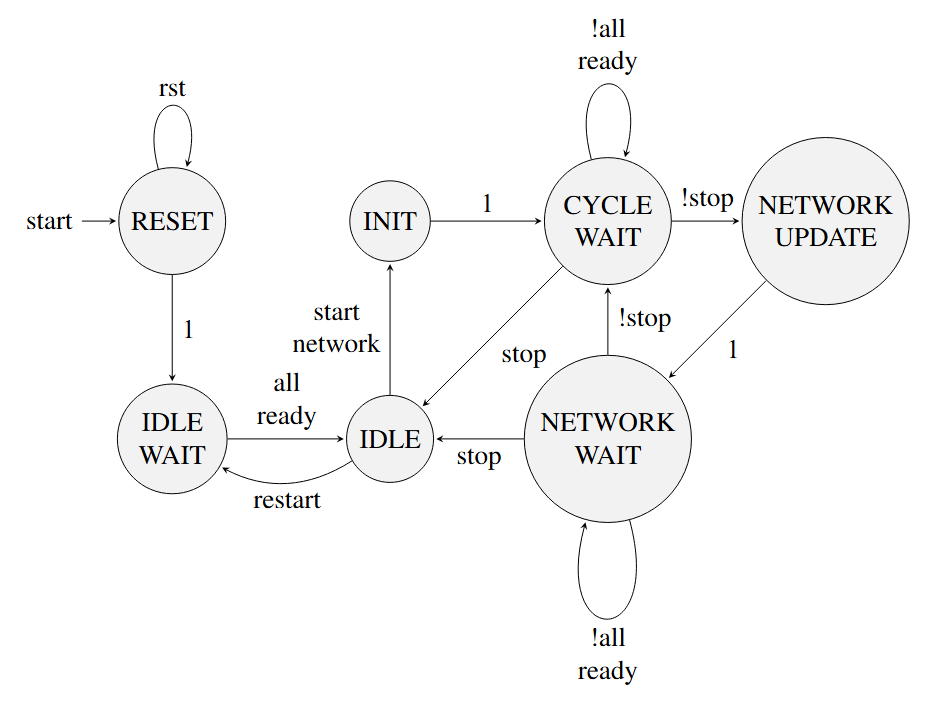 |

### 5.4 Design spec
| Item | Value |
|---|---|
| Topology | fully connected, multilayer, no bias |
| Neuron | LIF, shift-based leak, reset-subtract |
| Spikes | 1-bit, excitatory only |
| Weights | 8-bit fixed point (Q2.6), ROM from `.coe`, offline-trained |
| Coding | rate and latency |

## 6. Verification
Bottom-up with **cocotb + Verilator**: each module (common blocks, LIF, layer) has a `test_*.py` in `rtl/verilog/*/test/`; generated top-levels are tested against the quantized snnTorch spikes/labels (`rtl/generated/*/test_SNN.py`).

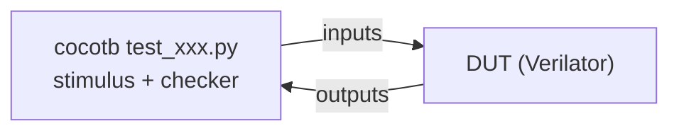

## 7. FPGA implementation
Platform: **Antminer S9 control board, Zynq-7000 XC7Z010-1CLG400C** (dual Cortex-A9, 512 MB DDR3, 1 V core), Vivado 2023.2.

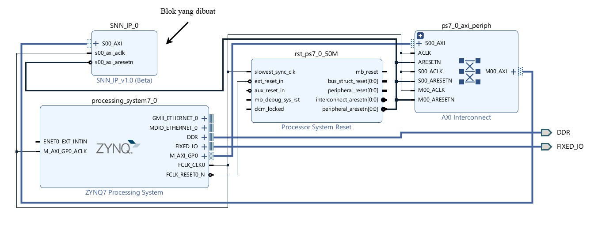

`SNN_IP_0` is a custom AXI-Lite slave (`fpga/axi_ip/`) wrapping `SNN.sv`, connected to the PS through the AXI interconnect (`fpga/design_2_32_64_3.tcl`). From PYNQ (`fpga/pynq/snn_test_FPGA.ipynb`), the PS writes one 32-bit word per timestep (packed 32-input spikes) at offsets `0 … 4·(T−1)`, then pulses control registers at `4·T` (start), `4·(T+1)` (reset), `4·(T+2)` (sample_ready), polls `4·(T+3)` (ready), then reads the output spike words back from offsets `0 … 4·(T−1)` (bit *k* = class *k*; the notebook counts spikes per class and takes the argmax). T = 50 timesteps for the implemented 32–64–3 `model1_rate`.

Utilization: **2,881 LUT, 2,895 FF, 8 BRAM** — plenty of the device left.

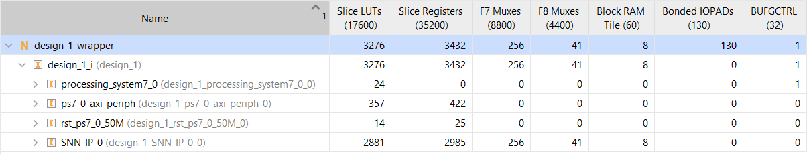

| Offline (float) | FPGA (Q2.6) |
|---|---|
| 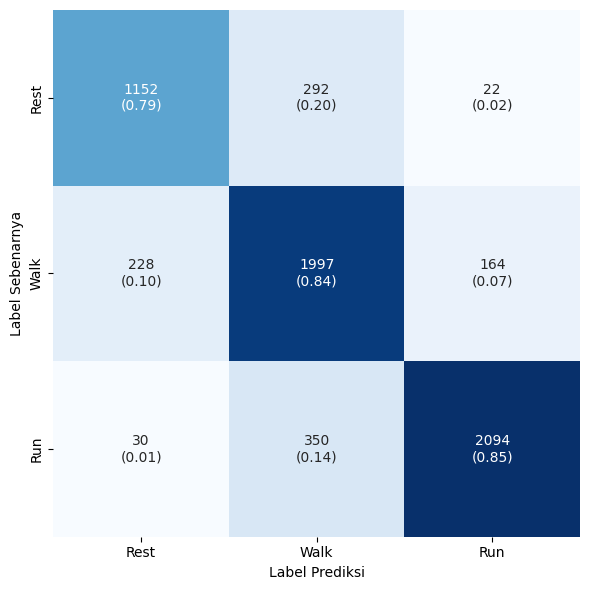 | 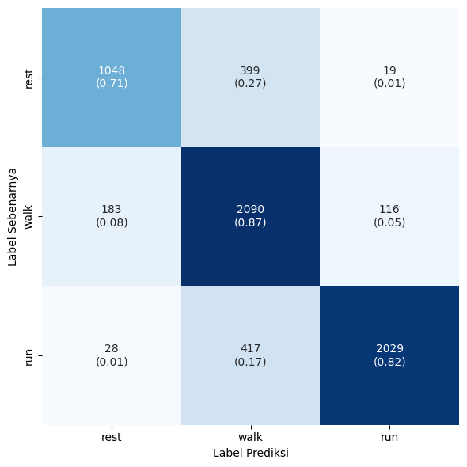 |

## 8. Latency and energy
Power is measured on the FPGA core rail: shunt resistor 0.2 Ω in series with the 1 V core supply, recorded by a Red Pitaya; `I = V_shunt / R_shunt`, `P = V_core · I`, `E = P · t`, energy per inference = total energy / N (N = 100 samples).

| Implementation | Energy / inference | Latency |
|---|---|---|
| SNN in software on PS (CPU) | 1.18 mJ | 28.508 ms |
| SNN on PL via AXI (PS + PL) | **0.462 mJ** | **15.608 ms** (15.522 ms PS I/O + 0.086 ms SNN core) |

Back-to-back 100-sample runs average 11.8 ms per inference. The latency is dominated by PS ↔ PL I/O, not by the SNN core.

| PL (RTL SNN) power trace | PS (CPU SNN) power trace |
|---|---|
| 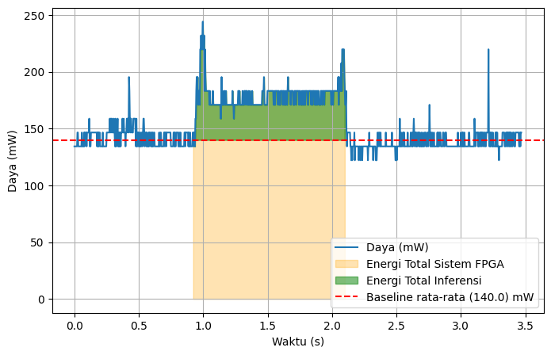 | 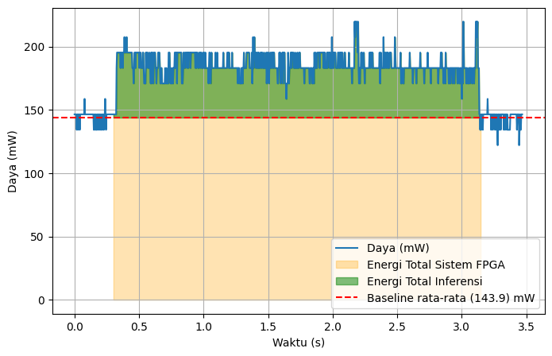 |

## 9. Source map
| Topic | Path |
|---|---|
| Training, weights, models | `training/` |
| LIF / layer / network RTL, tests | `rtl/verilog/{neuron,layer,network,common,weights}` |
| Network generator (veriloggen) | `rtl/build_network/` |
| Generated networks | `rtl/generated/` |
| Vivado block design, AXI IP, bitstream | `fpga/` |
| Power / latency data | `results/` |
